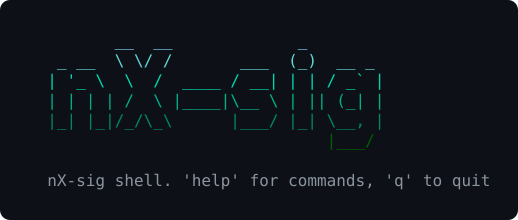
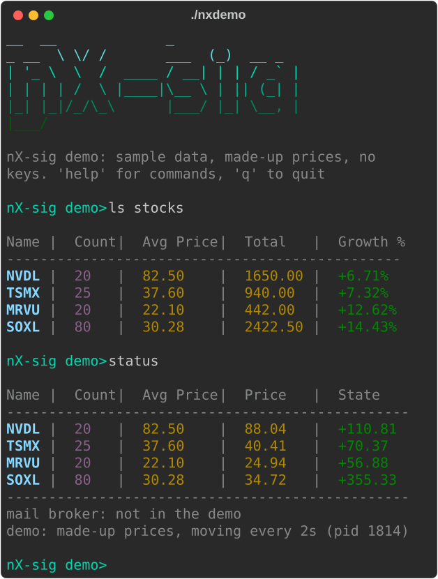
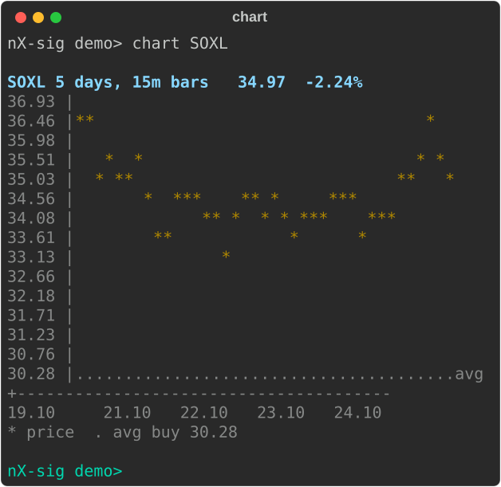
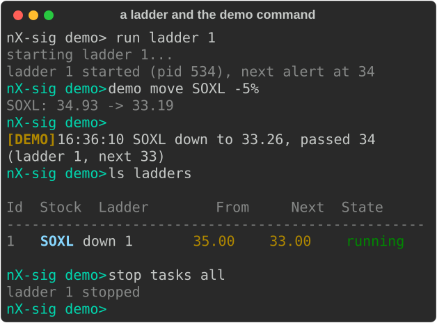

<p align="center">
  
</p>

[](https://github.com/serjhnn/nx-sig/actions/workflows/tests.yml)

[Features](#features) · [Demo](#try-the-demo) ·
[Requirements](#requirements) · [Setup](#setup) ·
[Running](#running) · [Data](#data) ·
[Layout](#project-layout) · [Tests](#tests) ·
[Code style](#code-style) · [Planned](#planned) ·
[venv](#python-virtual-environment)

<details>
<summary>Contents</summary>

- [Features](#features)
- [Try the demo](#try-the-demo)
  - [How the demo works](#how-the-demo-works)
- [Requirements](#requirements)
- [Setup](#setup)
- [Running](#running)
  - [The shell](#the-shell)
  - [The mail broker (mtsig, mail trades service)](#the-mail-broker-mtsig-mail-trades-service)
  - [Price chart](#price-chart)
  - [Ladders](#ladders)
  - [Basetrades](#basetrades)
  - [Alerts](#alerts)
    - [Gain alerts](#gain-alerts)
  - [Syncing the phone and the PC](#syncing-the-phone-and-the-pc)
    - [One device runs the background tasks](#one-device-runs-the-background-tasks)
- [Data](#data)
- [Project layout](#project-layout)
- [Tests](#tests)
- [Code style](#code-style)
- [Planned](#planned)
- [Python virtual environment](#python-virtual-environment)

</details>

**nX-sig** is a small terminal tool for tracking stock positions. It records
your buy and sell trades, keeps the count and average buy price of every
stock, shows live prices and your gain or loss, and can record broker orders
automatically from the confirmation emails. It is made to run on a phone in
[Termux](https://termux.dev): the output adjusts to the screen width by
itself, also when the window is resized or the phone turned, and fits a screen
as narrow as 48 characters (see `terminal` `width` below).

## Features

- **Interactive shell** (`./nxshell`) to add, list and delete trades,
  see positions with live prices and gain/loss, and keep personal trading rules
- **Live prices** from the [Alpaca](https://alpaca.markets) market data API
- **Mail trades service** (`./mtsig`) that waits for broker emails over IMAP and
  records FILLED orders as trades, running in the background
- **Plain files** for storage: CSV for trades, JSON for rules and state,
  written atomically and locked, so the shell and the mail broker can run together
- **Ladders**: background price-step alerts on Telegram or as Termux
  notifications, e.g. at 90, 80, 70, ... when a stock falls from 100
- **Alerts**: a message each time a basetrade's stock or a held
  stock's gain crosses a level, e.g. 10% below the buying price
- **Notifications** through Telegram, Termux:API or [ntfy](https://ntfy.sh) (config `notify`)
- **A demo** (`./nxdemo`) with sample data and made-up prices, to try it all
  without any account, see [Try the demo](#try-the-demo)

## Try the demo

```bash
git clone https://github.com/serjhnn/nx-sig.git
cd nx-sig
pip install -r requirements.txt
./nxdemo
```

`./nxdemo` starts the shell with sample trades, basetrades, rules, a ladder
and an alert, and with made-up prices that move by themselves, so every
feature can be tried without an Alpaca account, a mail account, a `.env` file
or the internet. Type `demo tour` for the commands to try, in order.

<p align="center">
  
</p>

`chart` draws the made-up price history, with the average buy price:

<p align="center">
  
</p>

A ladder or an alert sends its messages to the shell, marked `[DEMO]`, after
the next command. `demo move` moves a price at once, so you don't have to wait
for one:

<p align="center">
  
</p>

The pictures are made from a real run of `./nxdemo` by
`python scripts/gen_shots.py` (Linux or macOS), run it again when the output
changes.

The `demo` command works only in the demo:

| Command | What it does |
|---|---|
| `demo tour` | the commands to try, in order |
| `demo set NVDL 70` | sets a price; it moves on from there |
| `demo move SOXL -5%` | moves one stock, or `all`, by a percent (-90% to +1000%) |
| `demo speed [<n>]` | shows or sets how many times faster than real time the prices move (1 to 10000), until a reset |
| `demo reset` | stops the demo's ladders and alerts and starts over with the sample data and new prices |

### How the demo works

- **Its own settings and data**: it reads `demo/config.json` instead of
  `config.json` and keeps its data in `demo_data/` (not in git), so the real
  `data/` is never touched. The first start copies the sample data of
  `demo/seed/` there.
- **The prices** are a random walk per stock that wobbles around its starting
  price, with a year of made-up history for `chart`. A background process
  (`services/demo_prices_service.py`) moves them every `interval` seconds while
  the demo shell is open, or after it is closed while a ladder or the alerts of
  the demo still run, and ends by itself when nothing needs them (log:
  `demo_data/logs/demo_prices.log`). Every command that shows or checks prices
  uses them, with no keys and no network.
- **Messages** of the ladders and alerts don't go to `notify`: the shell
  prints them (the last 100 are kept in `demo_data/demo_messages.json`), and
  `test notify` works the same way.
- **Not in the demo**: the mail broker (`run mail-broker`), as it would record
  real broker emails, and syncing.

`demo/config.json` has the settings of the demo's prices in `"demo"`:

| Key | Meaning |
|---|---|
| `prices` | the starting price of each stock (`50` for a stock without one) |
| `volatility` | how much a price moves in a day, `0.05` is about 5% |
| `speed` | how many times faster than real time the prices move (`300`: 2 minutes are 10 hours); `demo speed` changes it until a reset |
| `interval` | seconds between two moves (`2`) |
| `seed` | a number for the same prices every time, `null` for other ones |

## Requirements

- Python **3.14+** (the mail broker uses IMAP IDLE, added to
  `imaplib` in 3.14)
- Python packages: `requests`, `python-dotenv` (and `rich` for `latest_trade.py`)
- An Alpaca account for prices, and an email account with IMAP access
  (e.g. Gmail with an app password) for the mail broker

## Setup

```bash
git clone https://github.com/serjhnn/nx-sig.git
cd nx-sig
pip install -r requirements.txt
```

On the phone, install the [Termux](https://f-droid.org/packages/com.termux/)
and [Termux:API](https://f-droid.org/packages/com.termux.api/) apps from
[F-Droid](https://f-droid.org), not from Google Play: the Play versions are
old and get old packages, and Termux:API only works with a Termux from the
same source. Termux:API is needed only for `notify` `"termux"`.

In Termux, install Python and git first: `pkg install python git`
(and `pkg install termux-api` for Termux:API).

Create a `.env` file in the repo folder with your keys (it is in `.gitignore`):

```ini
# prices (Alpaca market data)
APCA_API_KEY_ID=your-key-id
APCA_API_SECRET_KEY=your-secret-key

# mail broker (IMAP)
IMAP_HOST=imap.gmail.com
IMAP_USERNAME=you@gmail.com
IMAP_APP_PASSWORD=your-16-char-app-password
IMAP_SENDER=address-your-broker-sends-orders-from@example.com
# optional
IMAP_MAILBOX=INBOX
LOG_LEVEL=INFO

# notifications (optional)
NTFY_TOPIC=your-ntfy-topic
TOKEN=telegram-bot-token
CHAT_ID=telegram-chat-id
```

For Gmail, turn on 2-Step Verification and create an app password at
<https://myaccount.google.com/apppasswords>.

**About Telegram and privacy.** The alerts are encrypted on the way: nX-sig
sends them to Telegram's Bot API over HTTPS, and Telegram delivers them to
your app over its own encrypted connection. But they are not end-to-end
encrypted: a chat with a bot is a normal cloud chat, kept on Telegram's
servers, and Telegram holds the keys, so Telegram can read the alerts (stock,
prices, gain). Telegram's end-to-end "secret chats" are not available for
bots. Keep `TOKEN` private too: anyone with it can send and read messages as
your bot.

`config.json` holds the rest of the settings:

| Key | Meaning |
|---|---|
| `indices` | the stocks you track; only these can be used in commands and are recorded by the mail broker |
| `storage_dir` | where data files are kept, relative to the repo folder (default `./data/`) |
| `url`, `feed` | the Alpaca latest-trades endpoint and data feed (`ls basetrades sip` or `iex` chooses `delayed_sip` or `iex` for one listing, `xtop sip` or `iex` for one run) |
| `bars_feed` | the feed of the past prices for `chart` (default: `feed`, with `delayed_sip` read as `sip` and the newest 15 minutes left out); set `"iex"` if your plan refuses `sip` |
| `notify` | where the ladders and alerts are sent: `"telegram"` (default, `TOKEN` and `CHAT_ID` in `.env`) or `"termux"`, an Android notification through Termux:API (the Termux:API app and `pkg install termux-api`, no internet or keys needed), or `"ntfy"`, a push through [ntfy.sh](https://ntfy.sh) (`NTFY_TOPIC` in `.env`, the ntfy app subscribed to that topic); `test notify alert` in the shell sends a test |
| `fee` | the fee of one trade (a buy or a sell) in USD, a number of at least `0` (default `0`); each buy adds it to its cost, so the average buy price (`ls trades`, `xtop`, the gain alerts, `chart`) includes it, a sell's fee is left out |
| `timing` | how often the background tasks check the prices, see below |
| `terminal` | the shell's look on the screen, see below |

The `timing` settings, in seconds:

| Key | Meaning |
|---|---|
| `ladder_interval` | how often a ladder checks its price (default `30`) |
| `alert_interval` | how often the alerts check the prices (default `30`) |

The `terminal` settings:

| Key | Meaning |
|---|---|
| `width` | the shell's output width: a number (default `48`, the narrowest) or `"auto"` (as shipped) for the terminal's width, read anew for every command |
| `theme` | `"colored"` (default) or `"plain"` for no colors |
| `chart_height` | the number of price rows of `chart` (default `15`, at least `3`) |

With `auto`, the width is read again for every command, so the output adjusts
to the screen as it is now; it is never less than 48. On a screen wider than 48
the tables spread out (at most 4 more spaces between columns, so they don't get
thin), and messages and help texts fill the width.

To move the tables in from the left edge on a wide screen, set a padding: the
spaces before every table on this device, `0` (default) to `200`:

```
nX-sig> terminal padding 10
padding set to 10
nX-sig> terminal padding
padding: 10 (.terminal.json)
```

- It is saved in `.terminal.json` in the repo folder, like `.device` not in git
  and not synced, so the phone and the PC each keep their own.
- Where a table and the padding wouldn't fit the width, the table gets less
  padding, so it never wraps: on a 48 wide phone a table gets none.
- Only the tables move: their header, rows and total. The text below a table
  (the `al` alert lines, the `xtop` status line) fills the width and stays at
  the left, like messages and help.
- `terminal padding 0` puts the tables back at the left edge.

In the shell, `terminal info` shows the terminal's size, the width, theme and
padding in use and where they come from (`config.json`, `.terminal.json` or
the default), the
colors the terminal supports, the encoding, this device's name and the
phone's name (Settings, About phone) and model when Termux may read the
name, otherwise the phone or computer model. The width and theme are set only
in `config.json` `terminal`, the padding only with `terminal padding`. Without colors the output is the same, only plain; `NO_COLOR` or output that is not a terminal
also turns them off.

## Running

### The shell

```bash
./nxshell
```

It starts from the repo folder by itself, so `~/nx-sig/nxshell` works from
anywhere. Set `NXSHELL_PYTHON` to use a specific Python.

To try it without keys or accounts first, see [Try the demo](#try-the-demo).

Commands are `<action> <object> [arguments]`. The actions are `ls` (list or
show), `add` (save), `rm` (delete, after confirmation), `run` and `stop`
(background tasks). The object is plural after `ls` and singular everywhere
else: `ls ladders`, but `rm ladder 1`. The other plurals are `run alerts` /
`stop alerts` (one process runs every alert) and `stop tasks all`, which stops
every background task on this device.

| Object | Actions | e.g. |
|---|---|---|
| `stocks` | `ls` | `ls stocks`: held stocks with growth % |
| `trade` | `ls`, `add`, `rm` | `add trade SOXL buy count 10 price 20.5`, `add trade from <file>` (a bank statement, see below) |
| `ladder` | `ls`, `add`, `rm`, `run`, `stop` | `add ladder SOXL down 10 from 100 run` |
| `rule` | `ls`, `add`, `rm` | `add rule never buy on a gap up` |
| `basetrade` | `ls`, `add`, `rm` | `add basetrade MRVU price 100 count 10`, `add basetrade SOXL` or `all` (from the trades, see below) |
| `alert` | `ls`, `add`, `rm`, `run`, `stop` | `add alert basetrades down 10 percent` |
| `mail-broker` | `run`, `stop` | `run mail-broker` |
| `tasks` | `ls`, `stop` | `ls tasks`: running background tasks, `stop tasks all` stops them |

And the commands of their own: `status` (positions with gain/loss and the
mail broker's state), `xtop [sec] [sip|iex] [al]` (live gain/loss,
`sip` or `iex` the feed as in `ls basetrades`, with `al`
the gain alerts below the table, `q` to stop), `chart <stock> [period <n> <unit>]` (a
price chart, see below), `terminal info` (the terminal's size, width
and theme), `test notify <alert|ladder>` (a test message through
`notify`), `help [<command>]` and `exit`.

Every command with its arguments is in **[COMMANDS.md](COMMANDS.md)**, the same
text as `help` in the shell (`help add trade`, `help rm`, `help ladder`).

An action alone lists its objects (`ls` prints `ls: stocks, trades, ...`).
Keywords with a value, like `count 10 price 20.5`, may come in either order.
Tab completes actions, objects, stock names, ids and keywords.

The average price is a weighted average of your buys:
`avg = (avg × count + price × bought) / (count + bought)`. Sells lower the count
and keep the average. Gain/loss in `status` is `count × price − count × avg`.

### The mail broker (mtsig, mail trades service)

```bash
./mtsig start      # run it in the background
./mtsig start force  # also when the other device runs the tasks
./mtsig status     # running or not, last order, last log lines
./mtsig stop       # stop it cleanly
./mtsig restart
```

It waits for new emails from `IMAP_SENDER`, reads the order with
`scripts/mtsig/order_parser.py` and records it when its status is `FILLED` and the
symbol is in `indices`. Emails like this one are understood (a
translation in brackets after each label is allowed too):

```
Symbol TSMX
Quantity 10
Executed Price 87.54
Order Type Buy  LMT  DAY
Status *FILLED*
```

- It remembers the last email it handled, so after a restart it picks up the
  emails it missed and never records an order twice. On the very first start it
  begins after the newest email, so old emails are not imported.
- A dropped connection is reconnected automatically.
- `./mtsig` finds a Python 3.14+ by itself, or uses `WATCHER_PYTHON`.
  In Termux it takes a wake lock while it runs, so Android does not pause it.
- Logs are in `data/logs/mtsig.log` (rotated at 1 MB, 5 files kept).
  `LOG_LEVEL=DEBUG` in `.env` logs more detail.
- If an order is found but can't be saved, the log and `status` in the shell
  show `ORDER NOT RECORDED` with the `add trade` command to add it by hand.

### Importing a bank statement

```
nX-sig> add trade from ~/storage/downloads/statement.csv
added 1 trades from statement.csv:
  AVGG BUY 10 @ 18.219, 22.10.26 19:46
skipped 1:
  order 460827: no stock VOO
```

Records the trades of a bank statement csv
(`scripts/engines/statement.py`). A row is a trade when its 5th column
starts with the order text, and the 6th is the amount:

```
"22/10/26, 19:46","22/10/26, 19:46","Փոխանցում հաշվին","GTN EUROPE ...",
"Պատվեր թիվ 699534, 2026/10/22, 10.00 հատ AVGG առք","-182.19 USD",...
```

- `առք` is a buy (the amount must be negative), `վաճառք` a sell (positive).
- Date and time come from the 1st column, the price is amount / count.
- Every other row is left out without a word: fees
  (`Միջնորդավճար / Պատվեր ...`; the price stays as executed and config
  `fee` is added to the average instead), transfers, headers.
- Skipped, with the reason: order rows that can't be read (a fractional
  count, a wrong sign, a bad date), stocks not in `indices` and trades
  already recorded (same stock, date, time, type, count and price), so a
  statement can be imported again.
- The trades go into the trades files in date order, so the average price
  stays right when an older trade is imported after newer ones; the Ids of
  the trades already there don't change.
- A relative path is read from the nX-sig folder; use an absolute or `~` path.

### Price chart

```
nX-sig> chart TSMX period 5 days

TSMX 5 days, 15m bars   80.00  +0.00%
88.00 |       *
87.00 |      * *        *        *        *
86.00 |     *        * *        *        *
85.00 |               *        *        *
84.00 |    *    *   *    *   **   *    *   *
83.00 |...*......B.*........*............... avg
82.00 |  *        *        *        * *
81.00 | *        *        *        * *
80.00 |*
      +-------------------------------------
       12.10   13.10  14.10   15.10  16.10
* price  B buy  . avg buy 83.00
```

`chart <stock> [period <n> <days|weeks|months>]` (5 days by default, up to 5
years) draws the price from Alpaca's bars: the coarsest bars (daily, hourly or
15 minutes) that still give a price for every column, so 20 days get hourly
bars and a year daily ones. One `*` per price; more prices than columns are
averaged, so the chart always fits the width, and where there are fewer (a
short period, a holiday) the empty columns get points on the straight line
between the two prices next to them. Your average buy price is the `.`
line and your trades in the period are `B` / `S`, at their time and price.

### Ladders

```
nX-sig> add ladder SOXL down 10 from 100 run
ladder 1 saved: SOXL down every 10 from 100
starting ladder 1...
ladder 1 started (pid 366), next alert at 90
```

Each ladder is its own process (`scripts/services/ladder_service.py`), so it keeps running when
the shell is closed. It checks the price every `ladder_interval` seconds (see
`timing` above) and sends a message (see `notify` above) when the price passes the next level, like
`SOXL down to 89.50, passed 90 (ladder 1, next 80)`. When the price jumps over
several levels between two checks, one message names the farthest one.

- The last level sent is saved, so after `stop ladder` and `run ladder <id>`,
  or a phone restart, no level is sent twice.
- A down ladder ends when its next level would be 0 or less (`done` in
  `ls ladders`).
- If a message can't be sent, the level is not saved and is sent at the next
  check.
- The `notify` channel (Telegram, Termux:API or ntfy) must be set up to start a ladder.
- In Termux a wake lock is held while a ladder or the mail broker runs.
- Logs are in `data/logs/ladder_<id>.log`.

### Basetrades

A basetrade is the price and count you last bought a stock at, one per stock
(`base_trades.csv`); the alerts below are checked against it. It doesn't
change the trades or their totals. Set it by hand or take it from the trades:

```
nX-sig> add basetrade SOXL price 15 count 3
added basetrade of SOXL: 3 at 15
nX-sig> add basetrade SOXL
replaced basetrade of SOXL: 3 at 15 (lowest buy
  since the last sell, 02.10.26)
```

- `add basetrade <stock>` takes the lowest buy since the stock's last sell,
  its price and count. Any sell, a partial one too, starts over; of two buys
  at the same price the later one counts. A stock without such a buy is an
  error.
- `add basetrade all` does it for each stock that has trades and prints one
  line per stock (`skipped` without such a buy). It asks once before it
  replaces older basetrades.
- `ls basetrades` lists them with the current price and the change %,
  `rm basetrade <stock>` deletes one.

### Alerts

```
nX-sig> add alert basetrades down 10 percent
alert 1 saved: basetrades down 10%
alerts started (pid 412)
```

An alert is a change from the buying price of every basetrade: `down 10
percent` is 90 for a basetrade bought at 100, and 18 for one bought at 20.
One process (`scripts/services/alert_service.py`) checks all alerts every `alert_interval`
seconds (see `timing` above) and sends a message (see `notify`) each time a stock
crosses the level, like `SOXL -10.5% at 17.90, bought at 20 (alert 1: down
10%)`. `up` works the same way above the buying price.

- It is sent again each time the price comes back over the level and crosses
  it once more. The price must first go back 1% of the buying price past the
  level, so a price that wobbles around it doesn't send a message every check.
- A stock already past the level when the alert is added is sent at once.
- A new basetrade (a new buying price) starts the stock over.
- The stocks past each alert are saved, so a restart sends nothing twice.
- `add alert` starts the process if it isn't running, `rm alert` of the last
  alert stops it; `run alerts [force]` and `stop alerts` start and stop it, and
  `ls tasks` shows it.
- `ls basetrades al` shows each alert's price per stock below the table, with
  a `!` where the price is past it (`ls basetrades` shows only the table):

```
alert 1 down 10%: MUU 45.45, SOXL 18.00!
! in alert: SOXL #1
alerts: running, last check 14:30
```

- Like the ladders, it needs the `notify` channel and runs only on the device that runs
  the background tasks. Logs are in `data/logs/alerts.log`.

#### Gain alerts

```
nX-sig> add alert gain TSMX 100
alert 2 saved: gain TSMX +100
nX-sig> add alert gain all 10 percent
alert 3 saved: gain all +10%
```

`add alert gain <stock|all> <n> [percent]` alerts on the gain of a held stock,
computed from your trades as in `xtop`: `gain TSMX 100` when the gain of your
TSMX position reaches +100, `gain all 10 percent` when any held stock is 10%
over its average buy price. A negative `<n>` is a loss: `gain all -50`.
The message is like `TSMX gain +105.00 (+17.5%) at 70.50 (alert 2: gain TSMX
+100)`.

- A gain alert is turned into a price per held stock (average buy price +
  100 / count, or the average buy price + 10%) and checked like the basetrade
  alerts, by the same process: sent each time it is crossed, after the price
  went back 1% of the average buy price.
- A trade that changes the count or the average buy price moves the level,
  and the stock starts over.
- Only stocks you hold are checked; `all` covers the ones you buy later too.
- `xtop al` lists the gain alerts below its table, and the stocks past one
  (`! in alert: SOXL #2`).

### Syncing the phone and the PC

`./syncnx` keeps `data/` the same on the phone (Termux) and the PC
(Linux) with [Syncthing](https://syncthing.net). The two devices connect
directly over Wi-Fi, a phone hotspot or USB tethering. No internet is needed,
and no outside server is used (global discovery and relays are off).

```bash
./syncnx setup        # install, start, print this device's ID
./syncnx setup <ID>   # also share data/ with device <ID>
./syncnx status       # ID, peers, folder state, web page
./syncnx stop
```

You can also open the web UI at http://127.0.0.1:8384 to see and change the
sync configuration (`./syncnx status` prints the address in use).

To pair the devices, run `setup` on both of them, then run `setup <ID>` on each
one with the other's ID. Before the first sync, only one device should have
data in `data/`. Otherwise, the files that differ end up as
`*.sync-conflict-*` copies.

- Only one device runs the background tasks (the mail broker, the
  ladders and the alerts), or every order would be recorded twice. See below.
- Don't record trades on both devices before they have synced.
- These stay on each device and are never synced: `.lock`, `logs/`,
  `mtsig.pid` and the `*_status.json` heartbeats (see `data/.stignore`).
- Replaced or deleted files are kept in `data/.stversions` (the last 10).
- Syncthing runs with its own config in `~/.config/nx-sig-sync`, so it doesn't
  touch another Syncthing on the same device. After a phone restart, run
  `setup` again to start it.

#### One device runs the background tasks

`data/tasks_owner.json` (synced) names the device that runs the mail broker,
the ladders and the alerts, shown by `status` and `ls tasks`
(`background tasks run on pc (since 16.10 14:30)`).

- `run ladder`, `run alerts`, `run mail-broker` and `./mtsig start` refuse to start when the
  other device runs them: stop them there first.
- When the last background task on a device stops, it releases them, so the
  other device can start them after the next sync.
- If the other device is off or crashed and can't stop them, take them over
  with `force`: `run ladder 1 force`, `run alerts force`,
  `run mail-broker force`,
  `./mtsig start force`. When the other device syncs again, its tasks see that
  and stop by themselves, without recording or sending anything.
- The devices only sync when they reach each other. Tasks started on both while
  they are apart both run until the next sync; then the later start wins and
  the other device's tasks stop.
- Each device keeps its own id and name in `.device` in the repo folder (not
  synced, not in git). The name is `phone` and the model in Termux
  (`phone SM-S918B`, so two phones differ), otherwise the host name. It is set
  the first time; to rename a device, edit `name` in `.device` (keep `id`).

## Data

Everything is kept in `storage_dir` (`data/`, not in git):

| File | Contents |
|---|---|
| `<stock>_trades.csv` | the stock's trades: Id, Date, Time, Type, Count, Price |
| `personal_rules.json` | your rules |
| `base_trades.csv` | the basetrades (last buying prices), one per stock: Stock, Price, Count |
| `mail_state.json` | the last email the mail broker handled |
| `mtsig_status.json` | the mail broker's heartbeat, shown by `status` |
| `mtsig.pid` | the process id of the running `./mtsig` |
| `ladders.csv` | the saved ladders: Id, Stock, Direction, Step, From, Last (the last level sent), Created |
| `ladders_status.json` | the ladder processes' heartbeats, shown by `ls tasks` |
| `alerts.csv` | the alerts: Id, For (`basetrades` or `gain`), Direction, Percent, Created, Stock and Amount (of a gain alert) |
| `alerts_status.json` | the alerts process's heartbeat and the stocks past each alert |
| `tasks_owner.json` | the device that runs the background tasks |
| `logs/` | the background tasks' logs (`mtsig.log`, `ladder_<id>.log`, `alerts.log`) |

The count and average buy price of a stock are computed from its trades
file each time, so editing or syncing a trades file can't leave them out of
date. An old `trades_total.csv` is no longer used and can be deleted.

Data from before the rename of transactions to trades (the files
`<stock>_transactions.csv`, `transactions_total.csv` and `base_buy.csv`) is
renamed once with `./migrate_data`; run it on every device before using the
shell. The script is temporary and will be removed later.

## Project layout

The module map shows how the modules import each
other: [open it online](https://serjhnn.github.io/nx-sig/assets/modules.html)
(GitHub Pages, from `main`) or open
`assets/modules.html` in a browser.

```
nx-sig/
├── nxshell               start the shell
├── nxdemo                start the shell as a demo (demo/)
├── mtsig                 start/stop/status of the mail broker
│                         (mail trades service)
├── syncnx                sync data/ between phone and PC
├── migrate_data          renames old data files once (temporary)
├── config.json           stocks, data folder, price API
├── demo/config.json      the demo's settings (./nxdemo)
├── .terminal.json        this device's table padding (not in git,
│                         not synced, 'terminal padding')
├── demo/seed/            the demo's sample data
├── requirements.txt      the Python packages
├── .github/workflows/tests.yml
│                         CI: the tests on every push
├── CODE_STYLE.md         code style rules
├── CLAUDE.md             notes for Claude Code sessions
├── COMMANDS.md           every shell command (generated)
├── assets/logo.svg
├── assets/demo-*.svg     the demo pictures of this README
│                         (scripts/gen_shots.py)
├── assets/modules.html  the module map (generated), also online:
│                         serjhnn.github.io/nx-sig/assets/modules.html
├── tests/              the tests, test_<module>.py for scripts/<module>.py
│                         (test_shell.py: every shell command)
└── scripts/
    ├── commands.py       the shell: actions, help, collects the modules
    ├── engines/          the logic of each kind of data, used by the shell
    │   ├── trades.py         trades and their totals (count, average price)
    │   ├── statement.py      reads the trades out of a bank statement csv
    │   ├── prices.py         market prices from Alpaca (one-off and polling),
    │   │                     in the demo the made-up ones
    │   ├── rules.py          your personal rules
    │   ├── basetrades.py     the last buying price of each stock
    │   ├── ladder.py         price-step alerts, starts their processes
    │   ├── alerts.py         basetrade and gain alerts, starts their process
    │   ├── demo.py           the demo's sample data (./nxdemo)
    │   └── demo_prices.py    the demo's prices, a random walk
    ├── services/         the background processes, <engine>_service.py
    │   ├── ladder_service.py one ladder's process: price, notify
    │   ├── alert_service.py  the alerts process, one for all alerts
    │   └── demo_prices_service.py the demo's prices process
    ├── notifiers/        the notify channels (config "notify")
    │   ├── notifier.py       sends through the chosen channel
    │   ├── telegram_notify.py message through a Telegram bot
    │   ├── termux_notify.py  Android notification through Termux:API
    │   ├── ntfy_notify.py    push notification through ntfy.sh
    │   ├── demo_notify.py    the demo's messages, printed in the shell
    │   └── watch_notify.py   notes for a planned Garmin watch app
    ├── shell/            the shell's commands, one module per feature
    │   ├── interface.py      Commands: what every *_cmd.py implements
    │   ├── ui.py             colors, width(), padded tables, printing, parsers
    │   ├── trade_cmd.py      trades
    │   ├── stocks_cmd.py     ls stocks
    │   ├── rule_cmd.py       rules
    │   ├── base_trade_cmd.py basetrades
    │   ├── alert_cmd.py      alerts (the shell side)
    │   ├── ladder_cmd.py     ladders (the shell side)
    │   ├── mail_cmd.py       mail broker (./mtsig)
    │   ├── tasks_cmd.py      ls tasks
    │   ├── overview_cmd.py   status, xtop
    │   ├── chart_cmd.py      chart
    │   ├── notify_cmd.py     test notify
    │   ├── terminal_cmd.py   terminal info, terminal padding
    │   └── demo_cmd.py       the demo's messages and status line
    ├── mtsig/            the mail broker (mail trades service)
    │   ├── order_watcher.py  email -> parsed order -> trade
    │   ├── mail_reader.py    IMAP IDLE watcher with reconnects
    │   └── order_parser.py   reads an order from a broker email
    ├── config.py         reads config.json once, typed settings with defaults,
    │                     this device's padding (.terminal.json)
    ├── storage.py        trades, rules and mail broker state on disk
    ├── process.py        the helpers of the background processes
    ├── chart.py          the price chart of 'chart'
    ├── tasks_owner.py    one device runs the background tasks
    ├── sync.py           syncs data/ between phone and PC (Syncthing)
    ├── metrics.py        metrics engine: statistics of your actions (planned)
    ├── latest_trade.py   prints the latest prices once
    ├── gen_docs.py       writes COMMANDS.md from the help texts
    ├── gen_deps.py       writes assets/modules.html from the imports
    ├── gen_shots.py      writes the demo pictures (assets/demo-*.svg)
    └── check_style.py    checks the code style rules and the generated files
```

## Tests

```bash
python -m unittest discover tests  # all of them
python tests/test_config.py        # config.json settings and defaults
python tests/test_storage.py       # trades, totals, rules, locking
python tests/test_order_parser.py  # order email parsing
python tests/test_statement.py     # bank statement parsing
python tests/test_trades.py        # trades engine, statement import
python tests/test_ladder.py        # ladder levels
python tests/test_alerts.py        # alert levels and crossings
python tests/test_notifier.py      # the notify channel
python tests/test_tasks_owner.py   # which device runs the tasks
python tests/test_chart.py         # the price chart layout
python tests/test_demo.py          # the demo data, and a run of ./nxdemo
python tests/test_demo_prices.py   # the demo's prices and their process
python tests/test_shell.py         # every shell command, faked prices
python tests/test_sync.py          # device IDs, .stignore
python scripts/check_style.py      # code style (line width), generated files
```

GitHub Actions runs all of these on every push and pull request,
on Python 3.14 ([tests.yml](.github/workflows/tests.yml)),
and also checks that `order_watcher.py` and `mail_reader.py` compile
and that the shell scripts have no syntax errors. A red mark on the
commit (or the badge at the top) means something broke.

## Code style

The code is written to be read on a phone: lines are at most
60 characters and the shell's output at most 48 by default. See
[CODE_STYLE.md](CODE_STYLE.md) for the rules and how to check them.

## Planned

See [TODO.md](TODO.md).

## Python virtual environment

A virtual environment keeps nX-sig's packages apart from
the system Python. [uv](https://docs.astral.sh/uv/) makes
one quickly and can install Python 3.14 if it is missing.

Install uv (once):

```bash
curl -LsSf https://astral.sh/uv/install.sh | sh  # Linux
pkg install uv                                   # Termux
```

Make the venv in the repo folder and install the packages:

```bash
cd nx-sig
uv venv -p 3.14 .venv
uv pip install -r requirements.txt
```

`uv pip` installs into `.venv` in the current folder, no
need to activate it first. `.venv` is in `.gitignore`.

Activate it in each new terminal before starting nX-sig, so
`python3` is the venv's Python:

```bash
source .venv/bin/activate
./nxshell        # or ./mtsig, ./nxdemo, ./syncnx
deactivate       # back to the system Python
```

Or, without activating, point the scripts at the venv's
Python (e.g. in `~/.bashrc`):

```bash
export NXSHELL_PYTHON=~/nx-sig/.venv/bin/python
export WATCHER_PYTHON=~/nx-sig/.venv/bin/python
```

`NXSHELL_PYTHON` is used by `./nxshell`, `./nxdemo` and
`./syncnx`, `WATCHER_PYTHON` by `./mtsig`.
